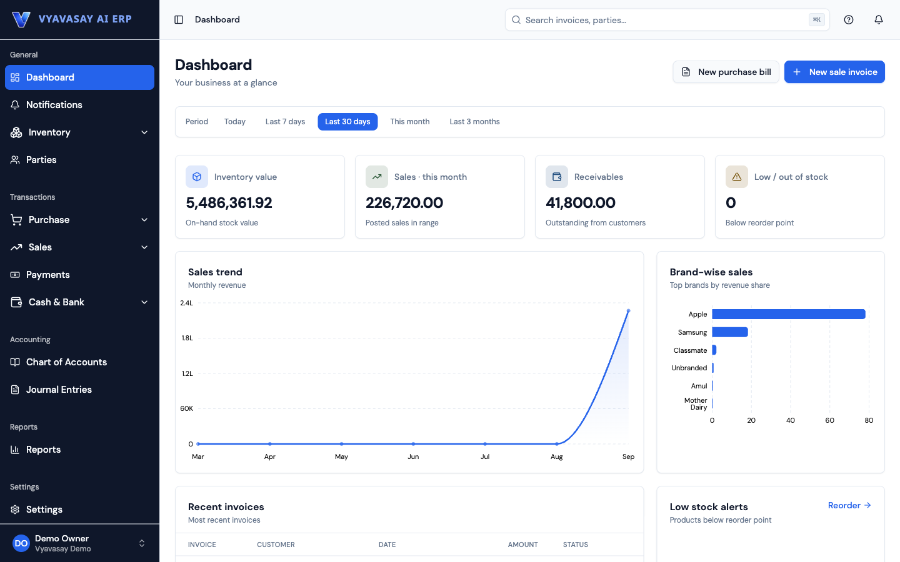

### Mahesh Moholkar

Software engineer in Pune. I build multi-tenant SaaS, distributed backends and production LLM systems.

<picture>
  <source media="(prefers-color-scheme: dark)" srcset="https://skillicons.dev/icons?i=nextjs,react,ts,py,fastapi,postgres,redis,dotnet,docker,aws&theme=dark">
  
</picture>

#### [Vyavasay](https://vyavasayapp.in/)

A multi-tenant GST ERP for Indian small businesses, designed, built and run in production. React web app, Next.js storefront, Expo Android app, .NET API.

- Posting is one transaction: stock, the double-entry ledger and balances move together, and cancelling reverses them.
- GST is split by place of supply and frozen at posting; GSTR-1 and 3B are built from posted documents, and filed periods are locked.
- Tenant isolation lives in the data layer, so a missed `WHERE` can't leak another business's data.
- One OpenAPI contract types all three clients, so an API change breaks the build, not production.
- Claude turns a photo of a supplier's bill into a draft purchase bill; the app finds products by photo with image embeddings in pgvector.

<a href="https://maheshmoholkar.in"><picture><source media="(prefers-color-scheme: dark)" srcset="img/globe-dark.svg"></picture></a>&nbsp;&nbsp;&nbsp;
<a href="https://linkedin.com/in/mahesh1822"><picture><source media="(prefers-color-scheme: dark)" srcset="img/linkedin-dark.svg"></picture></a>&nbsp;&nbsp;&nbsp;
<a href="https://maheshmoholkar.hashnode.dev"><picture><source media="(prefers-color-scheme: dark)" srcset="img/pen-dark.svg"></picture></a>&nbsp;&nbsp;&nbsp;
<a href="mailto:mahesh.moholkar.dev@gmail.com"><picture><source media="(prefers-color-scheme: dark)" srcset="img/mail-dark.svg"></picture></a>
